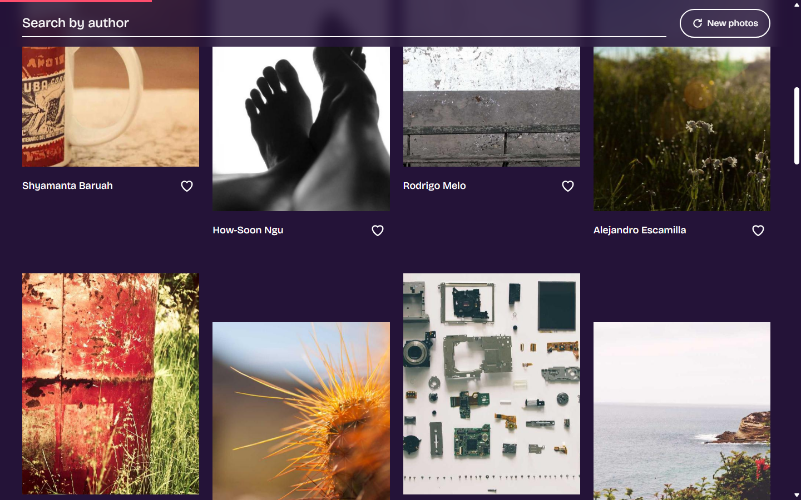

# Photo Gallery

A small photo gallery built with React, Vite and Tailwind CSS. It loads photos from the [Picsum API](https://picsum.photos), lets you search by photographer, and remembers the photos you heart.

| Desktop | Phone |
| --- | --- |
|  |  |

## What it does

- Fetches 30 photos on load, with a loading spinner and an error message if the request fails
- Shows them in a responsive grid: 4 columns on desktop, 2 on tablet, 1 on phone
- Filters by author as you type, using the photos already loaded (no extra requests)
- Hearts a photo to save it as a favourite, and keeps favourites after a refresh using `localStorage`
- Loads a new random set of photos with the refresh button

## Running it

You need Node 18 or newer.

```
npm install
npm run dev
```

Then open the address it prints, usually `http://localhost:5173`.

Other scripts:

| Command | What it does |
| --- | --- |
| `npm run build` | Makes a production build in `dist/` |
| `npm run preview` | Serves the production build locally |
| `npm run lint` | Checks the code with oxlint |

## How the code is organised

```
src/
  main.jsx                     Entry point
  App.jsx                      Renders the gallery
  index.css                    Tailwind setup, colours, font and scroll animations
  hooks/
    useFetchPhotos.js          Fetches photos, returns photos, loading, error and reload
  state/
    favouritesReducer.js       Reducer for favourites, plus loading them from localStorage
  components/
    Gallery.jsx                Main component: search, favourites, layout
    PhotoCard.jsx              One photo with author and heart button
    SearchBar.jsx              Search input
    Marquee.jsx                Scrolling strip of photographer names
    Spinner.jsx                Loading indicator
```

### A few decisions worth knowing

- **Data fetching lives in a hook.** `Gallery` never calls `fetch` itself. `useFetchPhotos` handles the request, the loading and error states, and cancels the request if the page changes before it finishes.
- **Favourites use `useReducer`.** The reducer has one action, `TOGGLE`, which adds or removes a photo id. A `useEffect` saves the list to `localStorage` whenever it changes.
- **Search uses `useMemo` and `useCallback`.** `useMemo` avoids re-filtering when nothing relevant changed. `useCallback` keeps the handlers stable so the memoized `SearchBar` and `PhotoCard` can skip needless re-renders.
- **Images are resized.** Each card asks Picsum for a 600x750 version of the photo instead of the full-size original, which loads much faster.
- **Scroll effects are plain CSS.** The title shrinking, progress bar, photo reveal and parallax use CSS scroll-driven animations, so there is no scroll listener in JavaScript. They work in current Chrome and Edge. In browsers without support the page simply shows without them, and everything is switched off for people who prefer reduced motion.

## Built with

- [React](https://react.dev)
- [Vite](https://vite.dev)
- [Tailwind CSS](https://tailwindcss.com) v4
- [Picsum Photos](https://picsum.photos) for the images
